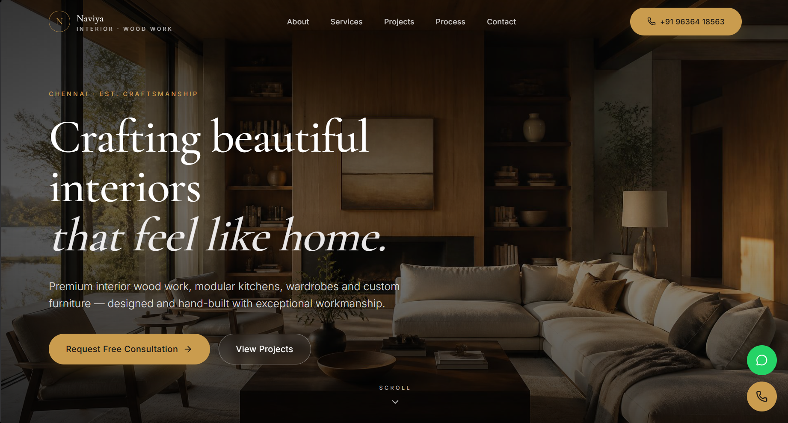
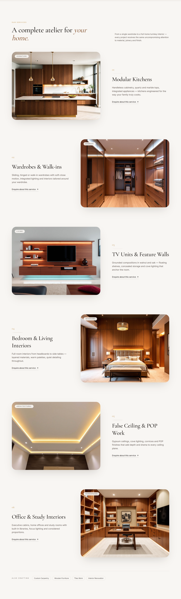
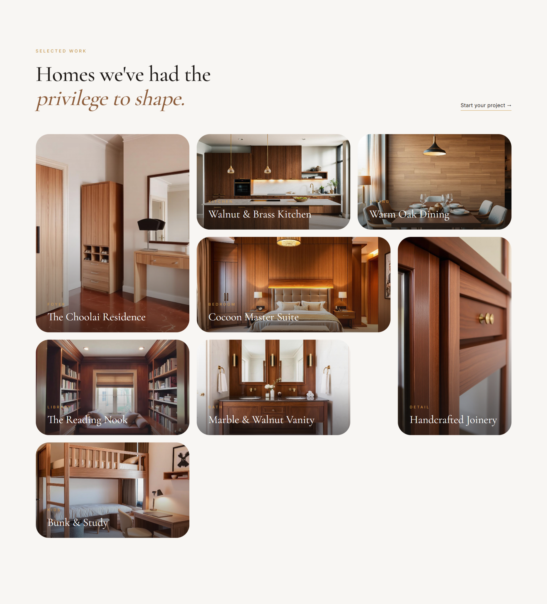
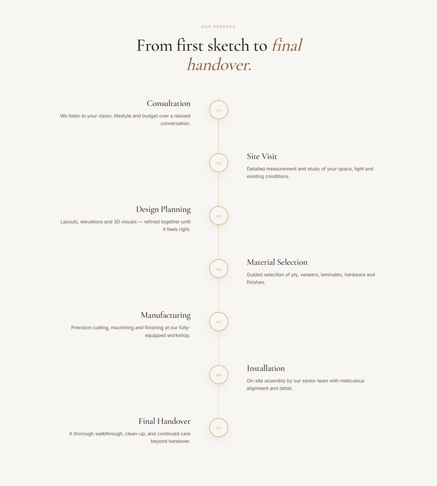
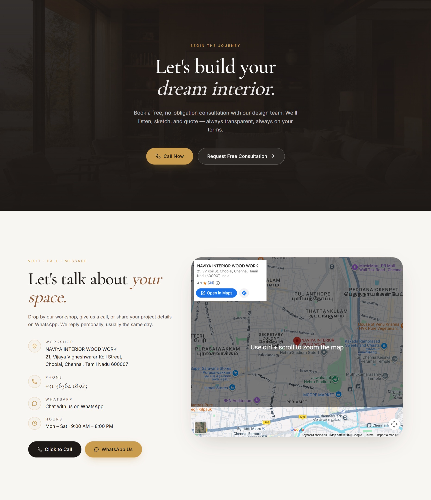

# Naviya Interior Wood Work — Website Demo

A modern, responsive website concept created to demonstrate my frontend development skills and showcase how a professional online presence could look for Naviya Interior Wood Work.

## Live Demo

🔗 **Live Website:** https://ar-naviya-interiors.vercel.app/

## Screenshots

### Home Page


### Services


### Projects


### Work Process


### Contact Section


## About the Project

This project is a **demo website concept** developed to showcase my ability to design and build a professional website for an interior woodwork business.

The goal was to create a clean, engaging interface that presents the business's services, highlights its work, explains its process, and makes it easier for potential customers to explore the business and find contact information.

This is an independently developed demonstration project, not an officially commissioned or launched business website.

## Features

- **Modern UI:** Clean layout and visual styling suited to an interior design and woodwork business.
- **Service Showcase:** Dedicated sections for presenting interior woodwork services.
- **Project Gallery:** A visual presentation of interior projects and design work.
- **Business Introduction:** Sections highlighting the business, its strengths, and its work process.
- **Testimonials Section:** A dedicated area for displaying customer feedback.
- **Contact Section:** Contact information and calls to action for potential enquiries.
- **Responsive Design:** Layout adapted for desktop, tablet, and mobile screens.
- **Animations:** Motion effects and transitions to improve the browsing experience.
- **Floating Actions:** Convenient access to contact options.

## Tech Stack

- **React** — Component-based UI development
- **TypeScript** — Type safety and maintainable code
- **Vite** — Development server and build tooling
- **Tailwind CSS** — Utility-first styling
- **TanStack Router** — Client-side routing
- **Framer Motion** — Animations and transitions
- **Swiper.js** — Interactive sliders and carousels
- **Lucide React** — Icons
- **TanStack Query** — Data-fetching and state-management utilities

## Run Locally

### Prerequisites

- Node.js
- npm

### Installation

1. Clone the repository:

   ```bash
   git clone <your-repository-url>
   ```

2. Navigate to the project directory:

   ```bash
   cd naviya-interiors
   ```

3. Install dependencies:

   ```bash
   npm install
   ```

4. Start the development server:

   ```bash
   npm run dev
   ```

5. Open the local URL displayed in your terminal.

## What I Practised

- Building reusable React components with TypeScript
- Creating responsive layouts with Tailwind CSS
- Structuring a business-focused landing page
- Implementing animations and interactive UI elements
- Organising page sections for a clear user experience
- Translating a business concept into a website demonstration

## Future Improvements

- Connect a backend or CMS to manage services and project galleries.
- Add a functional enquiry form with message delivery.
- Integrate a proper project gallery with category filters.
- Improve search engine optimisation and accessibility.
- Add analytics to understand visitor engagement.

## Project Status

**Demo / Concept Project**

Created independently to demonstrate my web development capabilities and present a possible website experience for Naviya Interior Wood Work. The project should not be interpreted as an official business website or an endorsement by the business.

---

**Developed by Abdul Rahuman S**

[Portfolio](https://rahuman.vercel.app/) · [LinkedIn](https://www.linkedin.com/in/abdul-rahuman-dev/)

